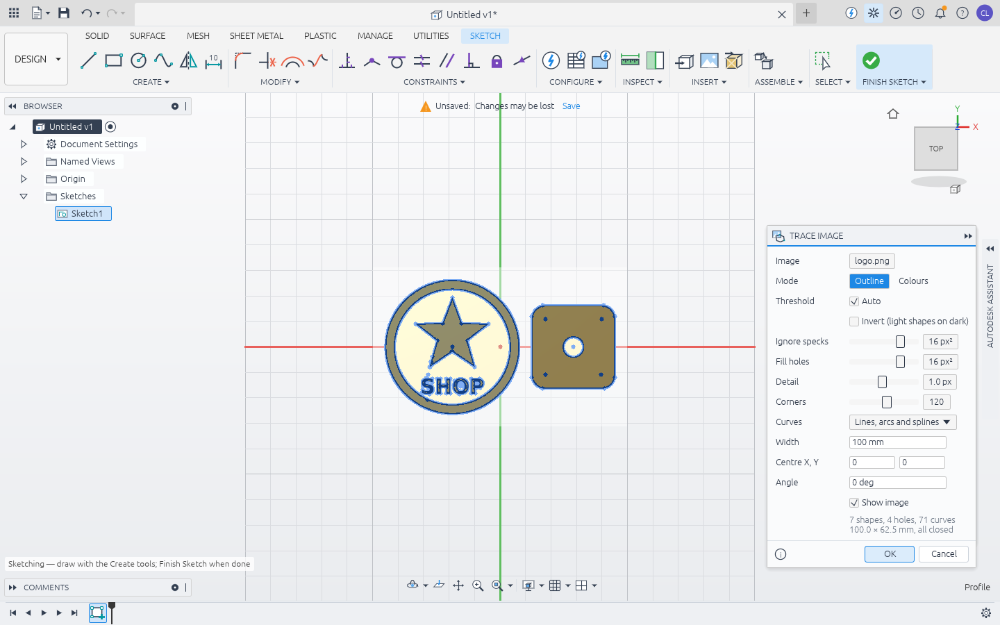

<h1>
  <picture>
    <source media="(prefers-color-scheme: dark)" srcset="brand/logo/wordmark-dark.svg">
    
  </picture>
</h1>

A parametric 3D CAD app in the spirit of Autodesk Fusion 360, written in Rust on the
OpenCASCADE kernel. Sketch, constrain, dimension, extrude and fillet your way to a part, then
change a parameter and watch the whole history rebuild.


## What works today

- **Parametric timeline.** Every feature is recorded; double-click one to edit it, roll the
  marker back, suppress or delete features. A failing feature turns red without stopping the
  rest of the timeline, as in Fusion.
- **User parameters and expressions.** Any value field takes `40 mm`, `width / 2 + 3`,
  `1.5 in`, `30 deg` or `sqrt(a^2 + b^2)`.
- **Constrained sketches.** Line/polyline and midpoint lines; two-point, centre and 3-point
  rectangles; centre, 2-point and 3-point circles; 3-point, centre and tangent arcs; fit and
  control point splines, ellipses and conics; inscribed, circumscribed and edge polygons; centre,
  overall, centre-point and arc slots; 2- and 3-tangent circles; blend curves (tangent or
  curvature continuous); points and editable text (glyph outlines you can extrude, rebuilt
  when you change the string, font, size or angle; double-click a letter to edit); 21 constraint types (coincident, horizontal,
  vertical, parallel, perpendicular, tangent, equal, concentric, midpoint, collinear,
  symmetric, fix, point-on-curve, curvature; tangency and curvature work on spline ends,
  which grow tangent handles); driving dimensions (distance, horizontal/vertical,
  radius, diameter, angle, point-to-line). The solver reports degrees of freedom, colours
  free geometry blue, and you can drag points.
- **Profiles.** Closed regions are found automatically, including holes and islands, so a
  rectangle with a circle in it gives you the ring and the disc. Curves that cross mid-span
  split each other, so two overlapping rectangles give three regions without trimming.
- **Solid features.** Extrude (one side, symmetric, two sides, through all one or both ways, to a
  face — flat or curved, with an offset past it — or to a body; starting at the sketch plane, an
  offset from it or a parallel face; taper angle; thin walls inside/outside/centred; new body,
  join, cut, intersect), revolve, fillet (edges or whole faces, tangent chains, several selection
  sets each with its own radius, constant or variable radius, setback corners where three filleted
  edges meet, asymmetric offsets for an elliptical round, full round across a rib), chamfer (equal,
  two distances, or distance and angle),
  press-pull and offset of flat or curved faces, shell, box/cylinder/sphere/torus, mirror,
  rectangular and circular patterns, move/rotate, scale (uniform or per axis), combine.
- **Construction geometry.** Planes offset, at an angle, midway, through three points or two
  edges, tangent to a round face, or along a path; axes through a round face, normal to a face,
  where two planes meet, through two points or along an edge; points at vertices, circle
  centres, edge/plane and three-plane intersections, or along a path. They follow the model and
  can be sketch planes, revolve axes and inputs to each other.
- **Threads, coils, pipes, ribs and webs.** Cosmetic or modeled (an ISO 60° helical groove)
  threads with ISO metric coarse pitches by default, coils with round, square or triangular
  wire, round, square or triangular pipes, solid or hollow, along all or part of a path, ribs and
  webs that grow until they meet the body.
- **Faces.** Split faces with a plane, remove faces (fillets, holes, bosses) and heal the body.
- **More solid features.** Loft (smooth or ruled, open or closed, along rails or a centre line),
  sweep along a path of lines and arcs (with a guide rail that turns and scales the profile, or a
  twist angle), holes at sketch points (simple, counterbore, countersink, drill point, through
  all), split body by a plane or by another body, draft, emboss/deboss of sketch profiles or text
  on flat or curved faces (projected, or wrapped around a cylinder), boundary fill (pick the
  closed cells bodies and planes bound), and replace face (a body's flat faces moved to a curved
  surface or a plane, its neighbours extended or trimmed). See `examples/solid_features.jsonl`.
- **Surfaces.** Extrude and revolve open curves into surfaces, patch a boundary of edges or a
  sketch, ruled surfaces between edges, offset surfaces (with per-face distances for a variable
  offset), trim with a plane, a solid, another surface or sketch curves projected onto them
  (keep either side, or pick the pieces to keep), untrim (remove holes and/or restore the
  untrimmed boundary), extend open edges (natural, tangent or perpendicular), stitch surfaces
  into a solid, unstitch, reverse normals, and thicken faces or surfaces into solids
  (`examples/surface_shroud.jsonl`).
- **Meshes.** Imported meshes become faceted bodies; reduce, smooth, or convert them back to
  clean B-rep (coplanar triangles merged into faces).
- **Sheet metal.** Sheet metal rules (thickness, bend radius, K-factor, driven by parameters);
  Flange from closed profiles, Contour Flange from an open path (corners become bends), Edge
  Flange (any angle, adjacent/inside/outside bend position, offsets), Lofted Flange between two
  profiles (die-formed or press-brake with a bend count, sharp or rounded bends), Miter Flange (a sketch profile swept
  along a chain of edges), Hem, Bend along a sketch line, Rip, Convert to Sheet Metal (sharp
  corners become bends, with corner reliefs), Unfold and Refold in the timeline (cuts made while
  flat are carried back onto the bends), corner closures where flanges meet (miter, open,
  closed, overlap, butt) with round, square or tear corner reliefs, rectangular or round bend
  reliefs, and a flat pattern with bend lines exported as a layered DXF with bend notes (also
  STEP/STL), checked against shop rules, or made into an editable sketch. The unfolder works on the B-rep, so holes and cuts anywhere — even across bends, and
  bends running straight into other bends — come out in the flat pattern. The flat pattern is
  also checked the way a shop checks a cut file: holes smaller than the material is thick, too little
  material between holes and edges, holes too close to a bend, a part too big for the sheet.
- **Assemblies.** Components (with grounding and physical materials), joints — rigid, revolute,
  slider, cylindrical, pin-slot, planar, ball — on faces, circular edges or points, with
  parameter-driven motion and limits, as-built joints, motion studies, interference checks and a
  bill of materials with masses. Component copies are linked: edit the original and every
  copy follows. Saved joint origins, rigid groups, motion links (gears, rack and pinion), contact
  sets that stop motion where bodies touch, and components inserted from other designs in the
  data hub as linked references that update to the source's newest version. Screw joints
  (rotation advances by a lead), cam followers that stay in contact with a turning cam, and
  inserted assemblies kept as nested sub-assemblies (rigid or flexible) with a bill of
  materials by level.
- **Drawings.** Sheets A4–A0, Letter, Tabloid; first- or third-angle standard views, isometric,
  section views with hatching, detail views, and sheet metal flat-pattern views with bend notes, all exact
  hidden-line projections; broken views; automatic overall dimensions, hole callouts and centre marks; manual,
  ordinate and angular dimensions (true lengths across breaks); GD&T feature control frames, datum identifiers and
  surface texture symbols per ASME or ISO; notes, a title block, an assembly parts list and balloons that follow it
  (or are placed automatically); export to PDF, SVG and DXF. Drawings live in the design and follow parameter
  changes.
- **Selecting and inspecting, as in Fusion.** Window selection (left to right picks what is
  inside, right to left what the box touches), freeform (lasso) selection by the same rule and
  paint selection (everything the brush passes over), Select Other (Alt+click or hold) for what's
  behind the front face, selection priority (face, edge, body, component) and filters, vertex
  picking (the Vertices filter shows body vertices as dots), joints and saved joint origins
  picked in the viewport by their glyphs, Select All and Invert. Measure between two bodies, faces or edges (distance, closest points, deltas, angle,
  drawn in the view); centre of mass; section analysis capped with the exact cut face; zebra,
  draft, accessibility and curvature-map analyses.
- **Drag manipulators.** Arrows for the extrude and press pull distance, the offset plane offset
  and the fillet and chamfer size; a move/rotate triad (three arrows, three rings, three planar
  handles) for Move, and an offset arrow and angle ring for Joint. A drag writes its dialog's
  fields, which still take typed values. While a command previews its result, the bodies as they
  were show through it as transparent ghosts.
- **Appearances.** Steel, aluminium (brushed or anodised), brass, copper, gold, ABS, plastic,
  rubber, wood and glass, on bodies or components (A).
- **Manufacture.** A milling workspace: setups with stock and a work origin, a tool library in
  the hub (flat, ball, bull-nose, drill and chamfer tools with feeds and speeds), facing, 2D
  pockets (islands stay standing, rest machining), adaptive clearing, 2D contours with holding
  tabs, ramp and helix entries, drilling (G81/G83), 3D parallel and scallop finishing, a stock
  removal simulation with gouge and collision warnings, and G-code for Fanuc, Haas, GRBL,
  LinuxCNC and Mach3/4 in mm or inches. See [Manufacture](#manufacture-cam).
- **Background regeneration.** Parameter changes and Compute All (Ctrl+B) recompute on another
  thread; the window shows the last image and a progress note instead of freezing.
- **Sketch tools.** Fillet, chamfer, offset, trim, extend, break, mirror (symmetry-constrained),
  rectangular and circular patterns, and project body edges into a sketch (the projection
  follows the body when it changes). Trim, break, extend and offset work on splines and
  ellipses too; what is left of an ellipse is an elliptical arc, of a fit-point spline a
  fit-point spline, and of other splines an exact Bézier chain with draggable handles.
- **Sketch on faces.** Sketches and features follow the faces and edges they were built on
  when the model changes: make the block taller and the hole on its top face moves up.
- **Files, like Fusion.** Open, insert and export STEP, IGES, BRep, STL, OBJ, 3MF, PLY and DXF;
  export glTF (`.glb`) and USDZ too. Opening a STEP or mesh makes a new design from it; meshes
  become faceted bodies you can cut and fillet. Designs are readable JSON (`.fox`) or a packed
  archive with thumbnail and version history (`.foxz`, FissionOxide's `.f3d`/`.f3z`). See
  [File formats](#file-formats).
- **Data panel with version history.** Every save is a new version in a project, never an
  overwrite: open or compare any old version (also as a coloured diff in the viewport),
  promote it back to latest, mark milestones, comment on versions, browse recent designs,
  search, see the activity feed, restore from the trash, share the hub through a sync folder. See
  [Data panel](#data-panel-projects-and-versions).
- **Trace images.** Turn a photo, logo or scan into clean sketch geometry: Trace Image (sketch
  Create or Insert menu, or drop/open a picture) previews the outlines over the image as you
  adjust threshold, detail and corners, and writes lines, arcs, circles and splines that are
  closed by construction — every shape is a profile, ready to extrude, flange or cut. Colour
  mode traces each of N colours on its own. See [Image tracing](#image-tracing).
- **Scriptable, and AI-drivable.** Everything is a JSON command, so the GUI, the CLI and
  scripts all drive the same engine — and `fissionoxide-cli mcp` serves every command as a Model
  Context Protocol tool, so an AI agent such as Claude can model with it directly.
- **Configurations and base features.** A configuration table of named variants that override
  parameters, feature suppression, appearances and joint values; switch the active one from the
  browser, edit them in a table, export any of them. Turn design history off (the timeline
  becomes a base feature) or keep it on, and make direct edits — move face, press-pull, delete
  face — that collect in a Base Feature in the timeline. See
  [Configurations](#configurations-and-base-features).
- **Elliptical arcs and fit-point splines through the modify tools.** Trimming or breaking an
  ellipse leaves elliptical arcs (their own curve, also drawn with `sketch.elliptical_arc`) that
  stay on the ellipse while you constrain, drag, trim and extend them, split profiles where
  lines and circles cross them, extrude to exact ellipse faces and read and write DXF `ELLIPSE`
  arcs. A fit-point spline stays a fit-point spline after Trim, Break and Extend (through the
  fit points it keeps, its new ends holding their direction). Sketch text takes fonts from
  disk: a font file's path or the name of one in the system's font folders (`sketch.fonts`).
- **3D milling and arcs.** 3D adaptive roughing of the stock around the part, pencil,
  steep-and-shallow and contour (waterline) finishing, and G2/G3 arcs (helical too) fitted to
  the toolpaths in the G-code. See [Manufacture](#manufacture-cam).
- **Laser, plasma and waterjet cutting.** A flat pattern, faces or a sketch to G-code or R12
  DXF: kerf compensation with true arcs, leads in the scrap, holes first, micro-joints, and
  machine profiles you can add to. See [2D cutting](#2d-cutting-laser-plasma-waterjet).

## Install

**Windows 10 and 11 (x64):** download `FissionOxide-<version>-x64-setup.exe` from
[Releases](https://github.com/leckliter/FissionOxide/releases) and run it. The setup wizard asks
whether to install for you only (no administrator rights needed) or for all users, where to
install, whether to add a desktop shortcut and open `.fox`/`.foxz` designs with FissionOxide, and
how to handle updates. You get a Start menu entry, an entry in **Settings → Apps → Installed apps**
(with its uninstaller), and an icon in the notification area while FissionOxide runs (click it to
bring the window back; right-click for Check for Updates, Open Data Folder and Quit). Task Manager
lists it as *FissionOxide*.

**Updates.** FissionOxide looks for a newer release about once a day (Help → Check for Updates
looks now). Depending on what you chose, it downloads the update in the background and installs it
when you close the app (or straight away with *Restart and Update*), only tells you, or never
looks; change it in the Software Update window. Every download is checked against the release's
SHA-256 before it runs. Running a newer installer by hand also updates in place: same folder, same
settings, one entry in Installed apps. Uninstalling keeps your designs; it asks before removing
settings. Settings live in `%LOCALAPPDATA%\FissionOxide` (`FOX_CONFIG_DIR` moves them).

Other platforms: build from source as below.

## Build and run

You need Rust (stable), CMake and a C++17 compiler. The first build compiles OpenCASCADE 7.8
from source into `target/OCCT` (about 20 minutes on 4 cores); later builds reuse it.

```sh
cargo run --release -p fissionoxide                         # the app
cargo run --release -p fissionoxide -- examples/bracket.fox # open a design
```

The first time the app starts it opens **FissionOxide**, the fox logo in 3D, and keeps it in the
data hub's Default Project (see [brand/README.md](brand/README.md#using-it)).

Set `FOX_OCCT_DIR` to an existing OCCT 7.8 install (`include/` and `lib/`, static libraries)
to skip the source build.

On Linux the app needs the usual X11/Wayland libraries (`libxkbcommon-x11`, Mesa/OpenGL).

See [CONTRIBUTING.md](CONTRIBUTING.md) for tests, CI and how to add a feature end to end.

## Using it

| Action                 | How                                                         |
|------------------------|-------------------------------------------------------------|
| Orbit / pan / zoom     | Right-drag / middle-drag (or Shift+right-drag) / wheel, or the navigation bar's Orbit, Pan and Zoom modes |
| Standard views         | Click the ViewCube faces; ⌂ or Home for the home view       |
| New sketch             | Select a planar face, then Create Sketch, or pick XY/XZ/YZ; double-click an origin plane in the browser |
| Sketch tools           | L line, R rectangle, C circle, A arc, P point, D dimension, T trim, O offset |
| Spline                 | Fit Point Spline: click points, then click the last one again (or Enter) |
| Angle dimension        | Dimension tool: Shift-click a line, then click another line |
| Construction geometry  | Select curves, press X                                      |
| Extrude / Fillet       | E / F (select profiles or edges first)                      |
| Hole / Press Pull / Joint | H / Q / J                                                |
| Drawings               | Workspace switcher → Drawing (or File → New Drawing from Design); wheel zooms the sheet, right-drag pans, double-click fits; Finish Drawing returns |
| Components and joints  | Right-click a component in the browser to rename, ground, duplicate or delete it; double-click a joint to drive it |
| Picking in a command   | With a command dialog open, clicks add to (or remove from) its selection |
| Edit a feature         | Double-click it in the timeline                             |
| Window selection       | Left-drag with the select tool: left to right = fully inside, right to left = touching |
| Freeform / paint selection | 2 / 3 (1 for window again), or SELECT ▾; a lasso that sets off to the right takes what's inside, to the left what it touches |
| Select Other           | Alt+click, or hold the mouse button still; SELECT ▾ also sets selection priority and filters |
| Measure                | Select one or two bodies, faces or edges, then I            |
| Drag arrow             | In Extrude, Press Pull, Fillet, Chamfer or Offset Plane, drag the arrow head |
| Move / rotate triad    | In Move or Joint: drag an arrow, a ring (5° steps) or a square |
| Joints in the viewport | Click a joint origin's glyph to use it in Joint, a joint's to drive it (or select it) |
| Appearance             | A                                                           |
| Compute All            | Ctrl+B (in the background)                                  |
| Marking menu           | Right-click (without dragging): click an item, or anywhere in its direction; the list below has commands for what you clicked |
| All commands of a group | Click the group name under the toolbar icons (CREATE ▾, MODIFY ▾, …) |
| Undo / Redo            | Ctrl+Z / Ctrl+Y                                             |
| Save a version         | Ctrl+S (Ctrl+Shift+S: save as a new design)                 |
| Data panel             | The data panel icon in the top-left corner, or File → Show data panel |
| Open / insert files    | Ctrl+O / File → Insert, or drop files on the window         |
| Fit view               | F6                                                          |
| Tangent circles        | 2-Tangent Circle: click two curves, then where the circle goes (the cursor sets its size); 3-Tangent: click three curves near where it should touch |
| Blend curve            | Click near the ends of two curves (G1); Shift+click the second for G2 |
| Break                  | Click a curve: it splits at the crossings either side of the click, or at the click |
| Edit text              | Double-click a letter (or Modify → Edit Text); Explode Text makes plain curves |

## Sketch text and blends

```sh
fissionoxide-cli run examples/name_plate.jsonl --save plate.fox --png plate.png
```

A plate outlined by two lines joined with G2 blend curves, with raised text that is edited
after it was extruded (`sketch.text_edit`): the letters regenerate and the extrusion follows.
Text stays a text entity in the sketch (string, font, height, angle and an anchor point you can
dimension or drag); `sketch.text_explode` turns it into plain curves, and older files with
exploded text open unchanged.

## Sheet metal

```sh
fissionoxide-cli run examples/sheet_bracket.jsonl --save bracket.fox
fissionoxide-cli exec bracket.fox '{"cmd": "sheet.flat_pattern", "path": "bracket-flat.dxf"}'
```

Sheet metal bodies are ordinary solids that carry their rule, so every other feature (holes,
cuts, fillets, patterns) works on them. Bends are true cylinders: the flat length of a bend is
`angle × (bend radius + K × thickness)`. Edge flange height is measured from the outside of the
sheet to the tip (Fusion's default "outer" datum). The flat pattern DXF has the outline and holes
on layer `CUT` and bend centre lines on `BEND_UP` / `BEND_DOWN` (dashed), with a bend note at
each bend on `NOTES` and an `ETCH` layer for marking; `sheet.flat_sketch` makes the same
outline (and the bend lines, as construction lines) into a sketch on the stationary face, or on
XY at the origin, to dimension, extrude or export.

```sh
fissionoxide-cli run examples/sheet_hopper.jsonl --save hopper.fox
```

- **Lofted flange** (`sheet.lofted_flange`): a sheet between two sketch profiles, both closed or
  both open; the profiles are one face of the sheet. Points of the two profiles are matched by
  arc length, keeping the corners of either as facet boundaries, and closed profiles are opened
  at a seam (the rule's gap) so the flange can unfold. *Die formed* is one smooth surface;
  *press brake* is flat facets with straight bends between them, about `bends` of them. Its flat
  pattern is the neutral layer developed facet by facet; holes and notches cut in the flange
  later are carried into it, facet by facet. `rounded` rounds a press-brake flange's bends to
  the rule's bend radius (folds that converge too tightly to round stay sharp, with a warning).
- **Miter flange** (`sheet.miter_flange`): an open profile drawn on a plane across the first
  edge, starting on it, swept along a chain of edges of one face; the profile is where the face
  of the flange ends up, so the sheet is trimmed back by the first bend. Corners are mitred.
- **Corner closure**: where two flanges of one feature meet, `corners` is `miter` (cut along
  the bisector, leaving the rule's gap), `open`, `closed` (mitred with no gap, a welded seam) or
  `overlap` (the first flange runs over the end of the second) or `butt` (the walls run on, cut
  square, until their inside corners are the rule's gap apart; the bends stop with the sheet,
  leaving an open corner below the walls). The rule's `corner_relief`
  (`round`, `square`, `tear`; `corner_relief_size`) cuts a relief at the corner through the
  sheet and the bends; overlapping corners get a square one unless the rule says otherwise.
  `sheet.corner_closure` changes both on an existing flange.
- **Setbacks through bends**: a flange whose edge ends where an earlier flange's bend starts
  trims that bend back with the sheet (the earlier flange's wall keeps its length).
- **Flat pattern checks** (`sheet.check_dxf`, `fissionoxide-cli check-dxf FILE.dxf|DESIGN.fox`):
  a flat pattern DXF, or a body's flat pattern, against shop rules: every cut contour closed
  and unbranched, nothing cut twice, no hole, slot or web narrower than the minimum feature size
  (default the thickness) and holes at least 2·t + R from a bend line. The rules come from the
  body or the DXF's `SHEET T=… R=… K=…` note; `min_feature` and `hole_to_bend` override them.

## Assemblies and drawings

```sh
fissionoxide-cli run examples/arm_assembly.jsonl --save arm.fox
fissionoxide-cli exec arm.fox '{"cmd": "param.set", "name": "swing", "expr": "-45 deg"}' --save arm.fox
fissionoxide-cli exec arm.fox '{"cmd": "drawing.export", "path": "arm.pdf"}'
```

Group bodies into components, then joint them: a joint origin is a face (its centre and normal),
a circular edge (its centre and axis) or an explicit point. The moving component's origin is
brought onto the fixed one with the Z axes facing each other (so faces mate); `flip` aligns them
instead, `angle` and `offset` adjust the placement, and the joint's motion (`rotation`, `slide`,
`slide2`, `pitch`, depending on the type) can be any expression.

- **Joint origins** (`joint_origin`) save a frame on a component — a face, an edge or a point,
  turned, offset or flipped — that joints use as `{"origin": "Name"}`. It moves with its
  component, so whatever is jointed to it follows the component's own joints.
- **Rigid groups** (`rigid_group`) make components move as one: joints after the group in the
  timeline move every member, and members a joint before it didn't move (say, a part modeled
  next to an already jointed one) keep their place relative to the others as those move.
- **Motion links** (`motion_link`) drive one joint's motion from another's: when the leader
  moves `leader_value`, the follower moves `follower_value` (`360 deg` ↔ `2 * pi * 5 mm` is a
  rack and pinion with a 5 mm pitch radius). Links chain; loops are reported.
- **Contact sets** (`contact_set.create`) list components that can't pass through each other:
  Drive Joints and motion studies stop where their bodies first touch.
- **Insert Component** (`component.insert`, or right-click a design in the data panel) brings a
  hub design in as a component. Its bodies are stored in the design, so it opens without the
  hub; linked, `component.links` shows when the source has a newer version, `component.update_link`
  gets it, and `component.break_link` keeps a local copy.
- **Screw joints** (`"kind": "screw"` with a `lead`) slide along their axis by the lead for every
  turn of rotation (a negative lead is left-handed); motion links can turn them but not slide them.
- **Cam followers** (`cam_follower`) set a sliding joint's slide so its component stays in contact
  with a cam component wherever the cam's own joint has turned it: a knife edge touches where
  the slide line meets the cam, a flat follower the cam's furthest point; `clearance` keeps a
  gap (a roller's radius). Motion studies of the cam move the follower too.
- **Sub-assemblies.** Inserting a design that has components keeps them, as children of the
  inserted component (the browser nests them; `component.parent` nests components by hand).
  Joints that move a component move everything below it. The source's joints come along:
  rigid (the default) keeps the positions the source solved; `component.flexible` solves them
  again in this design so `component.drive` can move them (`component.sub_joints` lists them).
  `assembly.bom` is indented by level, or `"view": "top"` (top-level totals) or `"parts"`
  (leaf parts with quantities).

Drawings annotate model points in a view, so annotations move with their view and follow
parameter changes:

```sh
fissionoxide-cli run examples/link_bar_drawing.jsonl --save link_bar.fox
fissionoxide-cli exec link_bar.fox '{"cmd": "param.set", "name": "len", "expr": "600"}' --save link_bar.fox
fissionoxide-cli exec link_bar.fox '{"cmd": "drawing.export", "path": "link_bar.dxf"}'
```

- **Broken views** (`drawing.break`) leave a stretch of a view out, between two break lines a
  `gap` apart; dimensions, ordinates and hole callouts still read the true length.
- **Ordinate** (`drawing.ordinate`) and **angular** (`drawing.angle`) dimensions.
- **GD&T** (`drawing.feature_control`, `drawing.datum`, `drawing.surface_finish`): the 14
  characteristics with Ø zones, MMC/LMC and up to three datums; the drawing's `standard` (ASME,
  the default, or ISO) sets the decimal sign, the surface texture layout ("1.6" in the V, or
  "Ra 1,6" on the extension line) and which characteristics exist (ASME Y14.5-2018 has no
  concentricity or symmetry).
- **Balloons** (`drawing.balloon`) carry a component's parts list item number, worked out each
  time the drawing is drawn, so they renumber when the parts list changes; `auto_balloons`
  balloons every row that has none.
- **Sheets** (`drawing.add_sheet`, `drawing.set_sheet`, `drawing.remove_sheet`): a drawing has
  one or more sheets, each with its own views, notes, size and scale and a title block that
  numbers it ("Drawing1 · 2/3"); views go on the sheet named by `sheet`, else the active one (the
  last added, or the tab clicked in the Drawing workspace), and `drawing.move_view` moves them
  across. `drawing.export` writes every sheet: a PDF page each, a DXF with the sheets side by
  side, `name-1.svg`, `name-2.svg`, … (or one sheet with `sheet`). Drawings saved before sheets
  open as one sheet.
- **Baseline** (`drawing.baseline`) and **chain** (`drawing.chain`) dimensions: rows of
  dimensions from one origin, stacked `spacing` apart, or between consecutive points on one line.
- **Weld symbols** (`drawing.weld`): fillet, square, V, bevel, U, J, plug, spot and seam welds
  on the arrow side, the other side or both, with size, length-pitch, all-around, field weld and
  a tail; AWS A2.4 layout for ASME drawings (arrow side below the reference line), ISO 2553 for
  ISO ones (a dashed identification line).
- **Datum targets** (`drawing.datum_target`, points or circular areas) and **composite** position
  and profile frames (`lower` on `drawing.feature_control`).
- **Revision table** (`drawing.revision`, `drawing.remove_revision`) in the first sheet's top right
  corner; the next letter (ASME Y14.35: no I, O, Q, S, X, Z) by default, and the title block shows
  the latest revision.

## File formats

| Format                          | Open / insert | Export | Notes                                                           |
|---------------------------------|:-------------:|:------:|-----------------------------------------------------------------|
| FissionOxide design `.fox`          | ✓             | ✓      | The parametric design as JSON                                   |
| FissionOxide archive `.foxz`        | ✓             | ✓      | Design + thumbnail, optionally its whole version history        |
| STEP `.step` `.stp`             | ✓             | ✓      | AP214 assemblies: components, body names and colours both ways; surface-only files are sewn into shells/solids |
| IGES `.iges` `.igs`             | ✓             | ✓      | Faces are sewn; closed shells become solids                     |
| OpenCASCADE BRep `.brep`        | ✓             | ✓      | Lossless kernel format                                          |
| STL `.stl` (binary / ASCII)     | ✓             | ✓      | Imported meshes become faceted bodies (≤ 250k triangles)        |
| OBJ `.obj`, PLY `.ply`, 3MF     | ✓             | ✓      | 3MF honours units, components and build transforms              |
| glTF binary `.glb`, USDZ        |               | ✓      | Metres / Y-up for web and AR viewers                            |
| DXF `.dxf`                      | ✓             | ✓      | Lines, arcs, circles, polylines with bulges, splines and ellipses ↔ a sketch (R12, or R2000 when there are splines/ellipses) |
| SVG `.svg`                      | ✓             | ✓      | Paths, shapes, transforms ↔ a sketch; curves stay exact         |
| PNG, JPEG, BMP, WebP            | trace         |        | Traced into sketch curves (see [Image tracing](#image-tracing)) |
| Autodesk Fusion `.f3d` `.f3z`   | stored        |        | See below                                                       |

When a mesh comes from CAD, coplanar triangles are merged back into flat faces on import, so a
box STL turns into a six-faced box again.

**About Fusion's `.f3d`/`.f3z`.** They are zip archives, but the geometry inside is Autodesk
ShapeManager B-rep in an undocumented binary encoding that no open-source tool can read, and no
other program can write a file Fusion would accept. FissionOxide therefore does not pretend to:
uploading an `.f3d` to the data panel keeps the file (with versions) and shows its preview
image; `inspect` lists what's inside; standard-format files packed inside it are imported. For
the geometry, export STEP from Fusion (File → Export) and open that. FissionOxide's own `.foxz`
plays the `.f3d`/`.f3z` role: one file with the full parametric design and its history.

## Data panel: projects and versions

The data panel (📂) is FissionOxide's version of Fusion's: designs live in **projects** and
**folders** in a local hub (`~/.local/share/fissionoxide` on Linux, `%APPDATA%\FissionOxide` on
Windows, `~/Library/Application Support/FissionOxide` on macOS; set `FOX_DATA_DIR` to move it).

- **Save** (Ctrl+S) adds a version with an optional description and milestone name; the first
  save asks for a name and a project. Earlier versions are never overwritten.
- Select a design to see its **version history** with thumbnails, authors and times. Open any
  version, **promote** an old one to be the latest again, **compare** it with the latest
  (features and parameters added, removed or changed, and in the viewport: added geometry
  green, removed red, unchanged as a grey ghost, until the comparison window closes), mark or
  clear **milestones** (milestones can't be deleted), and **comment** on versions (💬; comments
  show under each version, are searchable and appear in the activity feed).
- **Upload** files (or drop them on the panel): designs and archives keep their history, STEP /
  IGES / mesh / DXF files are translated into designs that keep the original file, and other
  files (`.f3d`) are stored as they are.
- **Recent**, **search** (names, version descriptions, milestones, comments), the per-project
  **activity** feed, and a **trash** you can restore from.
- **Download** any version in any export format, or as a `.foxz` with its history.

The hub is plain files: `hub.json` (the index, replaced atomically) and one immutable file per
version, so the app and the CLI can use the same hub at the same time.

**Sharing a hub between machines.** Point `FOX_DATA_DIR` (or `--hub`) at a folder that
Dropbox, OneDrive, Syncthing, Nextcloud or a network drive keeps in sync. Nothing is lost when
two people save at once: version files and ids carry a tag of the process that made them, so
they never collide; every write of `hub.json` happens under a `hub.lock` and merges with what
is on disk (both saves are kept; if both made "v3", the later one becomes v4); and when the lock
is held by another machine the change goes to a `hub.conflict-….json` copy instead. Those, and
the conflict copies sync tools make (`hub (conflicted copy).json`, `hub.sync-conflict-….json`
…), are merged into `hub.json` the next time the hub is opened. A version whose index entry
arrived before its file says it is still syncing.

## Manufacture (CAM)

Switch the workspace to **Manufacture**. **New Setup** puts stock around the part (side and top
offsets) with the work origin (G54) at the top of the stock, minimum X/Y corner; Z is negative
into the stock. The setup also picks the post-processor and the G-code units. Then add
operations:

- **Face** takes the stock top down to the part's top in zigzag rows.
- **2D Pocket** clears down to the flat floor faces you pick, in rings from the centre out; holes
  in a floor stay as islands. Step-over, step-down and stock to leave are per operation.
  **Rest machining** cuts only what the setup's earlier operations left (the corners a larger
  tool couldn't reach): their toolpaths are run through the stock first.
- **2D Adaptive Clearing** clears the same pockets with a light, constant engagement: the cut
  starts as a helix at the pocket's widest point and grows by the step-over (the optimal load,
  10% of the tool by default) each pass, at full depth, linking through cleared space.
- **2D Contour** follows the part's outline (or picked faces) a tool radius outside — or inside —
  climb milled, in step-downs through the part. **Holding tabs** leave bridges of a given width
  and height at the bottom so the part stays in the stock.
- **Drill** drills every vertical hole (or the ones you pick), pecking if asked.
- **Parallel** and **Scallop** finish 3D surfaces on the triangulated part: rows, or rings a
  constant distance apart over the surface, with the tool (ball, bull-nose or flat) dropped onto
  it so it never cuts in.
- **Adaptive Clearing** (3D) roughs the stock around the whole part in levels a step-down apart,
  plus a level on each flat area: at each level the cut grows in from the open air around the
  stock (or from a helix in closed areas) by the optimal load, so the engagement stays about
  constant, keeping the stock to leave (0.3 mm by default) off the part.
- **Contour** (3D) finishes steep areas in waterline passes at constant heights a step-down
  apart (only where the part is at least the minimum slope steep); **Steep and Shallow** adds
  parallel rows on the areas below the threshold angle; **Pencil** runs one pass along each
  concave corner or fillet tighter than the tool, where it touches the part on two sides.

Pockets and contours enter by plunging, **ramping** along the cut, or down a **helix**, at the
ramp angle.

The **Tool Library** (SETUP ▸ Tool Library) is `tools.json` in the data hub; a hub without one
starts with a standard set. Operations take a tool by number (`tool_number`) or by diameter,
and keep a copy of it, so a design machines the same on another computer.

Toolpaths (cutting moves blue, rapids dashed orange) are drawn with the stock and follow design
changes; **Generate** reports the machining time. **Simulate** cuts the stock with the
toolpaths on a heightfield, shows what's left in the view (gouges in red) and warns about
gouges, rapids into the stock and cuts deeper than the flutes. **Post Process** writes the
G-code with the setup's post: Fanuc (`.nc`, `O` number, decimal points), Haas (`.nc`), GRBL
(`.gcode`, no tool changer: it stops for each tool, drilling written out), LinuxCNC (`.ngc`)
or Mach3/4 (`.tap`), in mm or inches.

Cutting moves that lie on a circle in the XY plane are written as **G2/G3 arcs** (centre by
I/J, helical when Z falls evenly along them, G17), within the setup's arc tolerance (0.01 mm by
default); `"arcs": false` on the setup or on `cam.post` keeps straight moves.

```sh
fissionoxide-cli exec part.fox '{"cmd": "cam.setup", "stock_side": 3, "stock_top": 1, "post": "haas"}' --save part.fox
fissionoxide-cli exec part.fox '{"cmd": "cam.adaptive", "floors": [{"point": [35, 25, 12]}], "tool_number": 3}' --save part.fox
fissionoxide-cli exec part.fox '{"cmd": "cam.simulate"}'
fissionoxide-cli exec part.fox '{"cmd": "cam.post", "path": "part.nc", "units": "inch"}'
fissionoxide-cli run examples/milling.jsonl --save milled.fox   # a whole job, start to finish
```

The simulation is a heightfield seen from above (no undercuts, no holder geometry), and there
are no 4/5-axis or turning toolpaths yet: check the G-code against your machine before running
it.

### 2D cutting: laser, plasma, waterjet

**2D Cut** (Manufacture ▸ ACTIONS, or `cut.gcode`) turns a sheet metal flat pattern, flat faces
or a sketch's closed loops into a cutting program. The contours are offset by half the kerf
into the scrap with true arcs, holes and parts nested in holes are found and cut before the
contour around them, the rest go nearest first, and each contour starts with a lead-in (arc or
line, shortened to fit small holes) and ends with an optional overcut and lead-out, all on the
scrap side. Micro-joints (tabs) keep parts in the sheet, and small holes can run at a reduced
feed. The part is on the right of the cut by default (outlines clockwise), the good side of a
clockwise-swirl plasma torch.

Machine profiles: GRBL and FluidNC lasers (M4 power that follows the speed), LinuxCNC
QtPlasmaC (`M3 $0`, material table via `M190`), plasma with torch heights in the G-code
(Mach-style), Wazer-style waterjet (lines only) and R12 DXF of the part geometry for OMAX-style
software. Each is a set of G-code templates plus any number of processes (kerf, feed, power,
pierce delay and heights per material); add your own with `cut.machine.add` (kept in the hub's
`machines.json`). Rapids are real rapids and there is no limit on processes.

```sh
fissionoxide-cli cut machines
fissionoxide-cli cut bracket.fox bracket.ngc --machine qtplasmac --process "3 mm mild steel, 45 A"
fissionoxide-cli cut bracket.fox bracket.gcode --machine grbl_laser '{"kerf": 0.15, "tabs": 2, "lead_in": "line"}'
fissionoxide-cli exec plate.fox '{"cmd": "cut.gcode", "sketch": 1, "machine": "dxf", "path": "plate.dxf"}'
```

The machine dialects were written from their documentation, not run on the machines: check a
program in your control's preview (and on scrap) before cutting parts. Nesting is not there yet.

## Headless CLI and scripting

```sh
fissionoxide-cli run examples/bracket.jsonl --save bracket.fox --export bracket.step --png bracket.png
fissionoxide-cli info bracket.fox
fissionoxide-cli exec bracket.fox '{"cmd": "param.set", "name": "width", "expr": "80"}' --save bracket.fox
fissionoxide-cli export bracket.fox bracket.stl
fissionoxide-cli render bracket.fox top.png --view top
fissionoxide-cli commands        # every command with its parameters
fissionoxide-cli formats         # every file format and what FissionOxide can do with it
fissionoxide-cli convert part.step part.3mf
fissionoxide-cli inspect part.f3d

# the data hub (add --hub DIR to use another hub)
fissionoxide-cli hub save '{"description": "first cut"}' --open bracket.fox
fissionoxide-cli hub list
fissionoxide-cli hub versions '{"item": "i3"}'
fissionoxide-cli hub compare '{"item": "i3", "a": 1}'
fissionoxide-cli hub comment '{"item": "i3", "version": 2, "text": "wall too thin at the boss"}'
fissionoxide-cli hub comments '{"item": "i3"}'
fissionoxide-cli hub download '{"item": "i3", "version": 2, "path": "bracket-v2.step"}'
```

### AI agents (MCP)

`fissionoxide-cli mcp [design.fox]` is a Model Context Protocol server on stdio. Each command is a
tool (dots become underscores: `sheet.edge_flange` → `sheet_edge_flange`); `view_render`
without a `path` returns a PNG of the model, optionally sectioned (`section: {plane, offset, flip}`)
or with an analysis (`analysis: zebra | draft | accessibility | curvature`). To use it from Claude
Code:

```sh
claude mcp add fissionoxide -- /path/to/fissionoxide-cli mcp
```

A script is one JSON command per line. Faces and edges can be named by a point on them, so
scripts don't depend on internal numbering:

```json
{"cmd": "sketch.create", "plane": {"point": [40, 0, 6], "normal": [0, 0, 1]}}
{"cmd": "sketch.circle", "center": [45, 15], "diameter": "hole"}
{"cmd": "extrude", "extent": "through_all", "flip": true, "operation": "cut"}
{"cmd": "fillet", "edges": [{"point": [6, 0, 6]}], "radius": 4}
```

### Commands for scripts and plugins

These exist so code driving the engine can inspect and tag what it builds (see
[docs/PLUGINS.md](docs/PLUGINS.md)):

- `transaction.begin` / `commit` / `rollback`: many commands as one undo step, or none.
- `body.topology`: every face and edge with its geometry and which faces meet at each edge.
- Feature results list `result_bodies`, the bodies the feature created or changed; `targets`
  on extrude, revolve, loft, sweep, primitives and flanges limits join/cut to those bodies.
- `attribute.set` / `get` / `find` / `delete`: named values on the design, bodies, components,
  features and sketch curves or points; saved with the design.
- `sketch.info` gives the sketch plane, curve lengths and boxes, each profile's box,
  perimeter and bounding curves, and the curves outside every profile; `samples` and `loops`
  add points along curves and profile boundaries.
- `sketch.transform` (move, rotate, scale) and `sketch.insert` (copy curves from a sketch, a
  DXF, an SVG or a `.fox`); `sketch.trace` (an image); `sketch.visible`; `selection`; `body.appearance` also takes `"#rrggbb"`.
- `view.render` writes a PNG with a chosen camera, only some bodies, no sketches or grid.
- Anywhere a plane is taken, `{"origin": [x,y,z], "normal": [x,y,z]}` is a free plane.

## Image tracing



Trace Image works on the sketch being edited (opening or dropping a picture starts a sketch on
the XY plane for it). The tracer (`fox-trace`) thresholds the picture (automatically, or at a
level you set; or reduces it to N colours), drops specks and fills pinholes, follows the pixel
outlines so that no two outlines ever touch, then fits lines, arcs, circles and cubic splines
within the *Detail* tolerance while keeping sharp corners sharp. Each outline is checked for
closure and self-intersection before it reaches the sketch, so the sketch's profile finder sees
every shape as a region: a ring is a ring, an `O` keeps its counter.

After OK the traced shapes (not their holes) are selected, so Extrude straight away gives the
part. The same thing is a command:

```json
{"cmd": "sketch.trace", "image": "logo.png", "width": "120 mm", "fit": "curves"}
```

It returns the counts, each colour layer, and `ink`: a point inside each traced shape to pass to
`extrude`'s `profiles`. `trace.info` reports the same without changing the design, and
[`examples/trace_logo.jsonl`](examples/trace_logo.jsonl) traces and extrudes a badge. The
pipeline and its guarantees are described in [docs/TRACING.md](docs/TRACING.md).

## Viewport renderer

The desktop viewport draws on the GPU (OpenGL 3.3 or ES 3.0, through egui's glow painter): the
scene is uploaded once and orbiting, panning and zooming only redraw it, so large models stay
smooth. It draws the same scene as the CPU rasterizer (`fox-render`) with the same lighting,
analysis shading, edges, sketch overlays, toolpaths, stock and transparency. Picking stays
exact: each pixel's pick id is drawn into a second buffer and read back when the view settles.

Display Settings (navigation bar) → GPU Renderer switches to the CPU rasterizer, which also
takes over by itself when OpenGL can't start; `FOX_RENDERER=cpu` starts with it. The CLI and the
MCP server always render on the CPU. Benchmarks: `cargo run --release -p fox-ui --example
viewport_bench` (a patterned real part) and `cargo run --release -p fox-render-gl --features
headless --example bench` (a synthetic part of several million triangles).

## Configurations and base features

A configuration is a named row of overrides: parameter expressions, suppressed or unsuppressed
features, body appearances and joint motion values; anything it doesn't override keeps the
design's own value. The browser's Configurations folder switches between them (click a row),
and Solid → Configure → Display Configuration Table edits every cell. Exports can pick a
configuration without switching to it:

```sh
fissionoxide-cli run examples/configurations.jsonl --save plate.fox
fissionoxide-cli export plate.fox plate-large.step --configuration Large
fissionoxide-cli render plate.fox plain.png --configuration Plain
```

Direct edits (Solid → Modify → Direct Edit, or `direct.move_face`, `direct.press_pull`,
`direct.delete_face`) don't record parameters: they go into a Base Feature in the timeline,
replayed on whatever the features before it build. Capture Design History off collapses the
timeline into one base feature holding the bodies as they are (Undo brings the history back);
on again, new features follow it. The design note is [docs/CONFIGURATIONS.md](docs/CONFIGURATIONS.md).

## Architecture

| Crate               | Role                                                                   |
|---------------------|------------------------------------------------------------------------|
| `fox-expr`          | Unit-aware expressions and parameter evaluation                        |
| `fox-sketch`        | Sketch geometry, constraint solver, profile (region) detection         |
| `fox-kernel`        | Own cxx bridge to OpenCASCADE: modeling, meshing, STEP/IGES/BRep       |
| `fox-model`         | The design document, feature timeline, regeneration and references     |
| `fox-exchange`      | Mesh formats, DXF, SVG, `.foxz` archives, Fusion archive inspection    |
| `fox-trace`         | Image tracing: pixels to closed lines, arcs, circles and Béziers       |
| `fox-store`         | The data hub: projects, folders, items, versions, comments, activity, trash; safe sharing through sync folders |
| `fox-render`        | CPU rasterizer with depth and picking buffers (same images in the CLI) |
| `fox-engine`        | Session, undo/redo, the JSON command set, scene building               |
| `fox-ui`            | The egui desktop UI                                                    |
| `fox-brand`         | Brand colours, fonts and the fox logo (generated from `brand/`)        |
| `fox-desktop`       | Settings, updates from GitHub releases, the Windows tray icon          |
| `apps/fissionoxide`     | Desktop app                                                            |
| `apps/fissionoxide-cli` | Headless runner, exporter and renderer                                 |
| `fox-render-gl`     | OpenGL renderer of the same scenes, with an id buffer for picking      |
| `fox-cut`           | 2D cutting: kerf offsets (`cavalier_contours`), leads, micro-joints, cut order, laser/plasma/waterjet posts |

Why OpenCASCADE: the pure-Rust B-rep kernels (truck, monstertruck) fail the coplanar booleans
that everyday modeling depends on (a boss standing on a face, a hole flush with a face).
OCCT handles them, plus fillets, shells and STEP. The bridge (`crates/kernel/cpp`) catches
every OCCT exception, so a failed fillet shows as a red timeline feature and never crashes
the app. The stock `opencascade` crate aborts the process when a fillet fails.

## Brand

FissionOxide was called CLFusion; `fox` is its short name in code (crates `fox-*`, the C++
namespace, `FOX_*` environment variables). Designs saved as `.fox`/`.foxz` before the rename still
open, and a data hub in the old `CLFusion` data directory moves to the new one on first start.

The brand kit is in [`brand/`](brand): the logo in every form (full colour, one colour, app icons,
wordmarks), the colour, type and spacing tokens, ready-made files for websites (CSS variables,
a Tailwind preset, favicons, a social card) and the `fox-brand` crate the app reads its colours
and logo from. The fox's colours are the app's icon families. Open
[`brand/index.html`](brand/index.html) for the guide and [`brand/README.md`](brand/README.md) for
how to use it.

## Licence

FissionOxide's own code is MIT OR Apache-2.0. It links OpenCASCADE, which is LGPL-2.1 with the
OCCT exception; keep that in mind if you distribute binaries.

See [ROADMAP.md](ROADMAP.md) for what's next.
