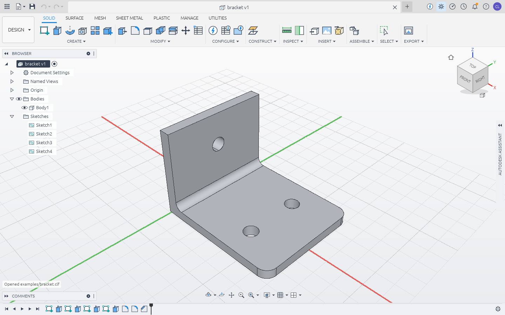

# CLFusion

A parametric 3D CAD app in the spirit of Autodesk Fusion 360, written in Rust on the
OpenCASCADE kernel. Sketch, constrain, dimension, extrude and fillet your way to a part, then
change a parameter and watch the whole history rebuild.



## What works today

- **Parametric timeline.** Every feature is recorded; double-click one to edit it, roll the
  marker back, suppress or delete features. A failing feature turns red without stopping the
  rest of the timeline, as in Fusion.
- **User parameters and expressions.** Any value field takes `40 mm`, `width / 2 + 3`,
  `1.5 in`, `30 deg` or `sqrt(a^2 + b^2)`.
- **Constrained sketches.** Line/polyline, two-point and centre rectangles, circles, 3-point
  and centre arcs, splines, polygons, slots and points; 20 constraint types (coincident, horizontal,
  vertical, parallel, perpendicular, tangent, equal, concentric, midpoint, collinear,
  symmetric, fix, point-on-curve); driving dimensions (distance, horizontal/vertical,
  radius, diameter, angle, point-to-line). The solver reports degrees of freedom, colours
  free geometry blue, and you can drag points.
- **Profiles.** Closed regions are found automatically, including holes and islands, so a
  rectangle with a circle in it gives you the ring and the disc. Curves that cross mid-span
  split each other, so two overlapping rectangles give three regions without trimming.
- **Solid features.** Extrude (one side, symmetric, two sides, through all, to a face; taper
  angle; thin walls inside/outside/centred; new body, join, cut, intersect), revolve, fillet
  (constant or variable radius), chamfer (equal, two distances, or distance and angle),
  press-pull of flat faces, shell, box/cylinder/sphere/torus, offset
  construction planes, mirror, rectangular and circular patterns, move/rotate, combine.
- **More solid features.** Loft (smooth or ruled, open or closed), sweep along a path of lines
  and arcs, holes at sketch points (simple, counterbore, countersink, drill point, through all),
  split body by a plane or by another body, draft.
- **Sheet metal.** Sheet metal rules (thickness, bend radius, K-factor, driven by parameters);
  Flange from closed profiles, Contour Flange from an open path (corners become bends), Edge
  Flange (any angle, adjacent/inside/outside bend position, offsets), Hem, Bend along a sketch
  line, Rip, Convert to Sheet Metal (sharp corners become bends, with corner reliefs), Unfold
  and Refold in the timeline (cuts made while flat are carried back onto the bends), mitered
  corners between flanges, rectangular or round bend reliefs, and a flat pattern with bend lines
  exported as DXF (also STEP/STL). The unfolder works on the B-rep, so holes and cuts anywhere —
  even across bends — come out in the flat pattern.
- **Assemblies.** Components (with grounding and physical materials), joints — rigid, revolute,
  slider, cylindrical, pin-slot, planar, ball — on faces, circular edges or points, with
  parameter-driven motion and limits, as-built joints, motion studies, interference checks and a
  bill of materials with masses. Component copies are linked: edit the original and every
  copy follows.
- **Drawings.** Sheets A4–A0, Letter, Tabloid; first- or third-angle standard views, isometric,
  section views with hatching, detail views, and sheet metal flat-pattern views with bend notes, all exact
  hidden-line projections; automatic overall dimensions, hole callouts and centre marks; manual
  dimensions, notes, a title block and an assembly parts list; export to PDF, SVG and DXF. Drawings live in the design
  and follow parameter changes.
- **Sketch tools.** Fillet, chamfer, offset, trim, extend, mirror (symmetry-constrained),
  rectangular and circular patterns, and project body edges into a sketch (the projection
  follows the body when it changes).
- **Sketch on faces.** Sketches and features follow the faces and edges they were built on
  when the model changes: make the block taller and the hole on its top face moves up.
- **Files, like Fusion.** Open, insert and export STEP, IGES, BRep, STL, OBJ, 3MF, PLY and DXF;
  export glTF (`.glb`) and USDZ too. Opening a STEP or mesh makes a new design from it; meshes
  become faceted bodies you can cut and fillet. Designs are readable JSON (`.clf`) or a packed
  archive with thumbnail and version history (`.clfz`, CLFusion's `.f3d`/`.f3z`). See
  [File formats](#file-formats).
- **Data panel with version history.** Every save is a new version in a project, never an
  overwrite: open or compare any old version, promote it back to latest, mark milestones,
  browse recent designs, search, see the activity feed, restore from the trash. See
  [Data panel](#data-panel-projects-and-versions).
- **Scriptable, and AI-drivable.** Everything is a JSON command, so the GUI, the CLI and
  scripts all drive the same engine — and `clfusion-cli mcp` serves every command as a Model
  Context Protocol tool, so an AI agent such as Claude can model with it directly.

## Build and run

You need Rust (stable), CMake and a C++17 compiler. The first build compiles OpenCASCADE 7.8
from source into `target/OCCT` (about 20 minutes on 4 cores); later builds reuse it.

```sh
cargo run --release -p clfusion                         # the app
cargo run --release -p clfusion -- examples/bracket.clf # open a design
```

Set `CLF_OCCT_DIR` to an existing OCCT 7.8 install (`include/` and `lib/`, static libraries)
to skip the source build.

On Linux the app needs the usual X11/Wayland libraries (`libxkbcommon-x11`, Mesa/OpenGL).

## Using it

| Action                 | How                                                         |
|------------------------|-------------------------------------------------------------|
| Orbit / pan / zoom     | Right-drag / middle-drag (or Shift+right-drag) / wheel      |
| Standard views         | Click the ViewCube faces; ⌂ or Home for the home view       |
| New sketch             | Select a planar face, then Sketch, or pick XY/XZ/YZ         |
| Sketch tools           | L line, R rectangle, C circle, A arc, P point, D dimension  |
| Angle dimension        | Dimension tool: Shift-click a line, then click another line |
| Construction geometry  | Select curves, press X                                      |
| Extrude / Fillet       | E / F (select profiles or edges first)                      |
| Edit a feature         | Double-click it in the timeline                             |
| Undo / Redo            | Ctrl+Z / Ctrl+Y                                             |
| Save a version         | Ctrl+S (Ctrl+Shift+S: save as a new design)                 |
| Data panel             | 📂 in the top-left corner, or File → Show data panel         |
| Open / insert files    | Ctrl+O / File → Insert, or drop files on the window         |
| Fit view               | F6                                                          |

## Sheet metal

```sh
clfusion-cli run examples/sheet_bracket.jsonl --save bracket.clf
clfusion-cli exec bracket.clf '{"cmd": "sheet.flat_pattern", "path": "bracket-flat.dxf"}'
```

Sheet metal bodies are ordinary solids that carry their rule, so every other feature (holes,
cuts, fillets, patterns) works on them. Bends are true cylinders: the flat length of a bend is
`angle × (bend radius + K × thickness)`. Edge flange height is measured from the outside of the
sheet to the tip (Fusion's default "outer" datum). The flat pattern DXF has the outline on layer
`OUTLINE` and bend centre lines on `BEND_UP` / `BEND_DOWN`.

## Assemblies and drawings

```sh
clfusion-cli run examples/arm_assembly.jsonl --save arm.clf
clfusion-cli exec arm.clf '{"cmd": "param.set", "name": "swing", "expr": "-45 deg"}' --save arm.clf
clfusion-cli exec arm.clf '{"cmd": "drawing.export", "path": "arm.pdf"}'
```

Group bodies into components, then joint them: a joint origin is a face (its centre and normal),
a circular edge (its centre and axis) or an explicit point. The moving component's origin is
brought onto the fixed one with the Z axes facing each other (so faces mate); `flip` aligns them
instead, `angle` and `offset` adjust the placement, and the joint's motion (`rotation`, `slide`,
`slide2`, `pitch`, depending on the type) can be any expression.
## File formats

| Format                          | Open / insert | Export | Notes                                                           |
|---------------------------------|:-------------:|:------:|-----------------------------------------------------------------|
| CLFusion design `.clf`          | ✓             | ✓      | The parametric design as JSON                                   |
| CLFusion archive `.clfz`        | ✓             | ✓      | Design + thumbnail, optionally its whole version history        |
| STEP `.step` `.stp`             | ✓             | ✓      | AP214 solids; surface-only files are sewn into shells/solids    |
| IGES `.iges` `.igs`             | ✓             | ✓      | Faces are sewn; closed shells become solids                     |
| OpenCASCADE BRep `.brep`        | ✓             | ✓      | Lossless kernel format                                          |
| STL `.stl` (binary / ASCII)     | ✓             | ✓      | Imported meshes become faceted bodies (≤ 250k triangles)        |
| OBJ `.obj`, PLY `.ply`, 3MF     | ✓             | ✓      | 3MF honours units, components and build transforms              |
| glTF binary `.glb`, USDZ        |               | ✓      | Metres / Y-up for web and AR viewers                            |
| DXF `.dxf`                      | ✓             | ✓      | Lines, arcs, circles, polylines with bulges ↔ a sketch          |
| Autodesk Fusion `.f3d` `.f3z`   | stored        |        | See below                                                       |

When a mesh comes from CAD, coplanar triangles are merged back into flat faces on import, so a
box STL turns into a six-faced box again.

**About Fusion's `.f3d`/`.f3z`.** They are zip archives, but the geometry inside is Autodesk
ShapeManager B-rep in an undocumented binary encoding that no open-source tool can read, and no
other program can write a file Fusion would accept. CLFusion therefore does not pretend to:
uploading an `.f3d` to the data panel keeps the file (with versions) and shows its preview
image; `inspect` lists what's inside; standard-format files packed inside it are imported. For
the geometry, export STEP from Fusion (File → Export) and open that. CLFusion's own `.clfz`
plays the `.f3d`/`.f3z` role: one file with the full parametric design and its history.

## Data panel: projects and versions

The data panel (📂) is CLFusion's version of Fusion's: designs live in **projects** and
**folders** in a local hub (`~/.local/share/clfusion` on Linux, `%APPDATA%\CLFusion` on
Windows, `~/Library/Application Support/CLFusion` on macOS; set `CLF_DATA_DIR` to move it).

- **Save** (Ctrl+S) adds a version with an optional description and milestone name; the first
  save asks for a name and a project. Earlier versions are never overwritten.
- Select a design to see its **version history** with thumbnails, authors and times. Open any
  version, **promote** an old one to be the latest again, **compare** it with the latest
  (features and parameters added, removed or changed), mark or clear **milestones**
  (milestones can't be deleted).
- **Upload** files (or drop them on the panel): designs and archives keep their history, STEP /
  IGES / mesh / DXF files are translated into designs that keep the original file, and other
  files (`.f3d`) are stored as they are.
- **Recent**, **search** (names, version descriptions, milestones), the per-project
  **activity** feed, and a **trash** you can restore from.
- **Download** any version in any export format, or as a `.clfz` with its history.

The hub is plain files: `hub.json` (the index, replaced atomically) and one immutable file per
version, so the app and the CLI can use the same hub at the same time.

## Headless CLI and scripting

```sh
clfusion-cli run examples/bracket.jsonl --save bracket.clf --export bracket.step --png bracket.png
clfusion-cli info bracket.clf
clfusion-cli exec bracket.clf '{"cmd": "param.set", "name": "width", "expr": "80"}' --save bracket.clf
clfusion-cli export bracket.clf bracket.stl
clfusion-cli render bracket.clf top.png --view top
clfusion-cli commands        # every command with its parameters
clfusion-cli formats         # every file format and what CLFusion can do with it
clfusion-cli convert part.step part.3mf
clfusion-cli inspect part.f3d

# the data hub (add --hub DIR to use another hub)
clfusion-cli hub save '{"description": "first cut"}' --open bracket.clf
clfusion-cli hub list
clfusion-cli hub versions '{"item": "i3"}'
clfusion-cli hub compare '{"item": "i3", "a": 1}'
clfusion-cli hub download '{"item": "i3", "version": 2, "path": "bracket-v2.step"}'
```

### AI agents (MCP)

`clfusion-cli mcp [design.clf]` is a Model Context Protocol server on stdio. Each command is a
tool (dots become underscores: `sheet.edge_flange` → `sheet_edge_flange`) and `view_render`
returns a PNG of the model. To use it from Claude Code:

```sh
claude mcp add clfusion -- /path/to/clfusion-cli mcp
```

A script is one JSON command per line. Faces and edges can be named by a point on them, so
scripts don't depend on internal numbering:

```json
{"cmd": "sketch.create", "plane": {"point": [40, 0, 6], "normal": [0, 0, 1]}}
{"cmd": "sketch.circle", "center": [45, 15], "diameter": "hole"}
{"cmd": "extrude", "extent": "through_all", "flip": true, "operation": "cut"}
{"cmd": "fillet", "edges": [{"point": [6, 0, 6]}], "radius": 4}
```

## Architecture

| Crate               | Role                                                                   |
|---------------------|------------------------------------------------------------------------|
| `clf-expr`          | Unit-aware expressions and parameter evaluation                        |
| `clf-sketch`        | Sketch geometry, constraint solver, profile (region) detection         |
| `clf-kernel`        | Own cxx bridge to OpenCASCADE: modeling, meshing, STEP/IGES/BRep       |
| `clf-model`         | The design document, feature timeline, regeneration and references     |
| `clf-exchange`      | Mesh formats, DXF, `.clfz` archives, Fusion archive inspection         |
| `clf-store`         | The data hub: projects, folders, items, versions, activity, trash      |
| `clf-render`        | CPU rasterizer with depth and picking buffers (same images in the CLI) |
| `clf-engine`        | Session, undo/redo, the JSON command set, scene building               |
| `clf-ui`            | The egui desktop UI                                                    |
| `apps/clfusion`     | Desktop app                                                            |
| `apps/clfusion-cli` | Headless runner, exporter and renderer                                 |

Why OpenCASCADE: the pure-Rust B-rep kernels (truck, monstertruck) fail the coplanar booleans
that everyday modeling depends on (a boss standing on a face, a hole flush with a face).
OCCT handles them, plus fillets, shells and STEP. The bridge (`crates/kernel/cpp`) catches
every OCCT exception, so a failed fillet shows as a red timeline feature and never crashes
the app. The stock `opencascade` crate aborts the process when a fillet fails.

## Licence

CLFusion's own code is MIT OR Apache-2.0. It links OpenCASCADE, which is LGPL-2.1 with the
OCCT exception; keep that in mind if you distribute binaries.

See [ROADMAP.md](ROADMAP.md) for what's next.
